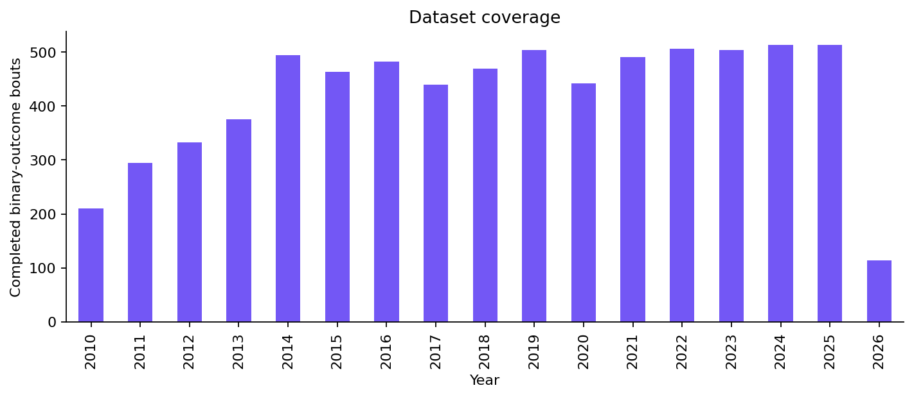
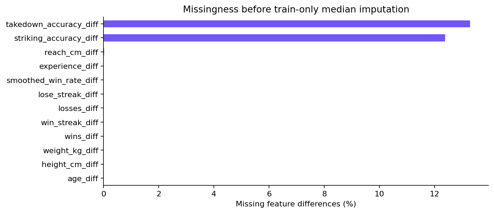
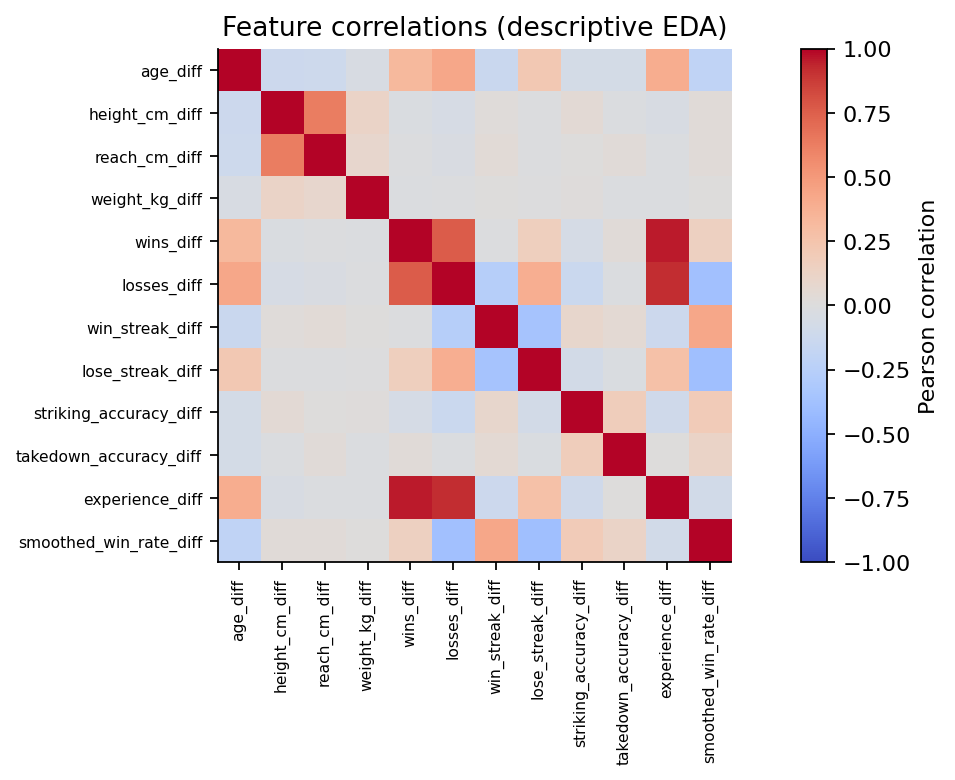
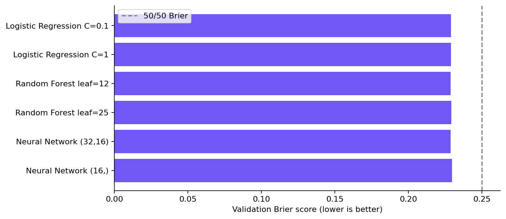
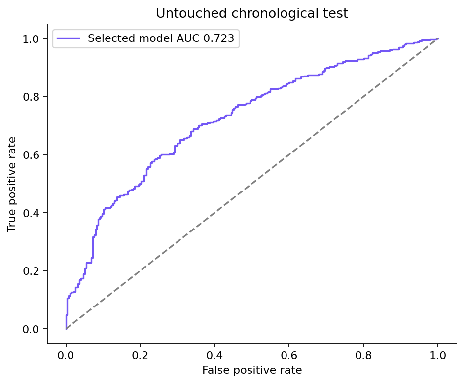
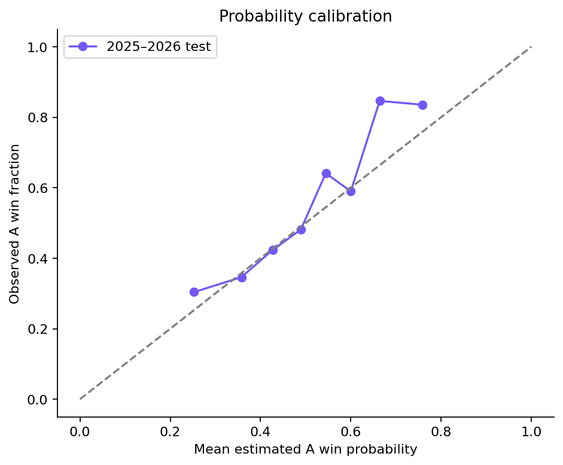
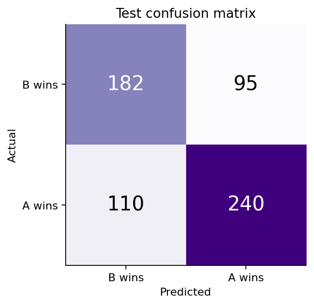
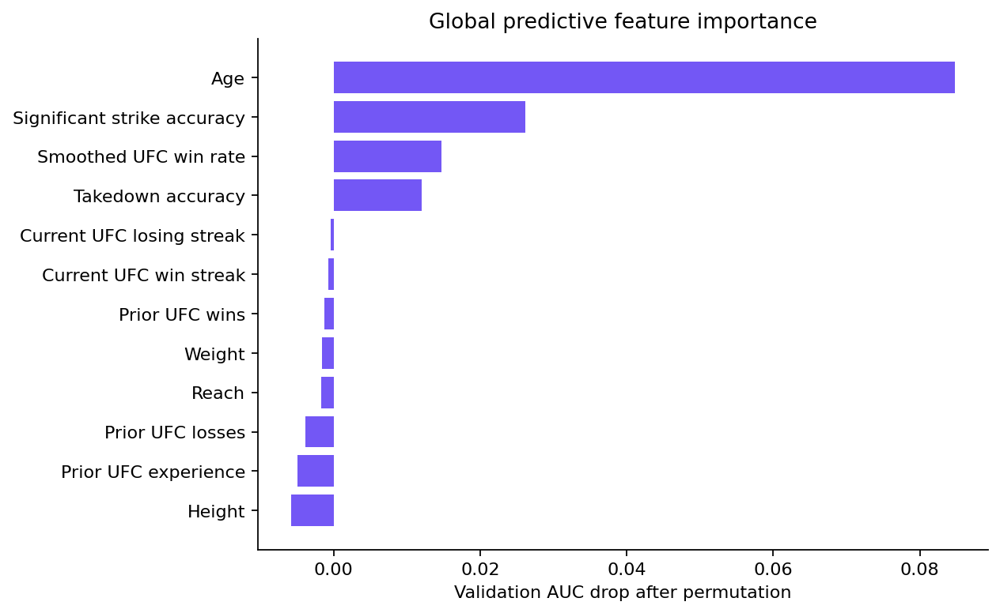
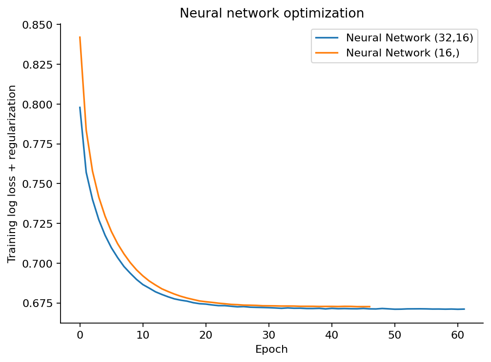

# FightPredict AI — Technical Report

## 1. Research question, users and objective

Can historical pre-bout physical attributes and performance measures predict the winner of a decisive UFC bout better than a simple prior? The prototype supports students, researchers and sports analysts comparing hypothetical matchups. This is supervised binary classification with probability estimation, not a causal analysis or prediction of injuries, finish method or betting returns.

The engineering objective is a reproducible trained model that accepts two fighters, returns complementary win probabilities and exposes measured quality. The research success criterion is lower held-out Brier score and higher ROC-AUC than a no-skill baseline. Brier was fixed as the model selection metric because the application displays probabilities.

## 2. Source, size, cleaning and audit

Source: [TidyTuesday UFC dataset, 2026-07-07](https://github.com/rfordatascience/tidytuesday/blob/main/data/2026/2026-07-07/readme.md), compiled through fightr from UFCStats and the Ultimate UFC Dataset. Raw files and the original dictionary are bundled. `data/raw/sources.json` contains source URLs, byte lengths and SHA-256 hashes. No synthetically generated fights are used.

The starting bout table has 7,177 rows and 118 columns. The separate history table contributes 8,735 deduplicated bouts and starts in 1994. The final modeling data contain **7,150 bouts**, spanning 2010-03-21–2026-03-28. The application catalog contains **2,182** latest pre-bout fighter snapshots.

Cleaning removes 8 non-binary outcomes or invalid dates, 0 duplicate unordered date/bout pairs, 14 outcome conflicts against the separate history table, and 5 fights without a matched history bout. Aliases are resolved using an exact shared event date and opposing athlete; 86 unambiguous aliases are recorded in `metrics.json`. This identity mapping uses names/date/opponents, not labels or performance features; it is retrospective entity normalization, not a deployable live identity service.

Examples of source problems: career aliases such as Bobby Green/King Green, a reach value outside the supported physical range, and an abrupt change in average significant-strike values from roughly 26–36 in early years to roughly 4 in recent years. Ambiguous average striking/takedown/submission rate columns are excluded rather than guessing their units.

Age, height, reach and weight come from bout-specific columns. Zero/out-of-range physical values become missing. Historical strike/takedown accuracy differences have about 12.4% / 13.3% missing values. A median imputer is fitted only on the augmented training set; it is saved inside the pipeline. Standard scaling is fitted only there as well. Scaling matters for Logistic Regression/MLP; it is harmless but unnecessary for the forest.

### Leakage controls and remaining provenance uncertainty

UFC wins, losses and current streaks are rebuilt from history dates **strictly before the target calendar day**. All fights on a day obtain features before any results from that day update the records. D/NC outcomes reset streaks and do not add W/L counts. Fighter IDs/names, odds/EV, rankings, finish details, ending round/time and current profile career totals are not model features. Same-day boundaries and the saved model's outputs are covered by tests.

Historical accuracy values are described as pre-bout by the source, but their effective collection timestamps cannot be independently certified. The project therefore does **not** claim complete historical provenance verification. An accuracy-free Logistic Regression sensitivity experiment is included. The earliest career records may be incomplete because the archive starts in 1994. Retroactively amended results can be reflected in current history; the source does not expose when amendments took effect. There is also no guarantee that every source-provided physical value is an original contemporaneous measurement.

## 3. Features and preprocessing

| Model input | Definition |
| --- | --- |
| age_diff | A age minus B age, in integer years |
| height_cm_diff / reach_cm_diff | A minus B, centimeters |
| weight_kg_diff | A minus B, converted from source pounds with factor 0.45359237 |
| wins_diff / losses_diff | A minus B observed UFC W/L counts before the bout day |
| win_streak_diff / lose_streak_diff | A minus B current observed UFC W/L streak; D/NC reset streaks |
| striking_accuracy_diff / takedown_accuracy_diff | A minus B provided historical pre-bout accuracy, percentage points |
| experience_diff | (A wins + A losses) minus (B wins + B losses) |
| smoothed_win_rate_diff | (A wins + 1)/(A wins + A losses + 2) minus the corresponding B fraction |

All inputs are differences from A to B, giving 12 numeric features. Symmetric augmentation adds `(-X, 1-y)` for every training bout only. It does not add independent observations or enlarge the original-bout counts. This avoids a model simply treating the historically favored red corner as inherently stronger.

## 4. Chronological experimental design

| Partition | Dates | Original bouts | Purpose |
| --- | --- | --- | --- |
| train | 2010-03-21 to 2022-12-17 | 5506 | Fit parameters and medians |
| validation | 2023-01-14 to 2023-12-16 | 504 | Choose one configuration |
| calibration | 2024-01-13 to 2024-12-14 | 513 | Fit probability calibration slope |
| test | 2025-01-11 to 2026-03-28 | 627 | Final evaluation only |

No random splitting across past and future fights is used. The same athlete can occur in earlier training fights and later test fights: the estimate measures future-bout performance, not unseen-fighter generalization. Individual event dates are kept in one partition. History results from earlier validation/test fights may inform a later fight's record, as they would in an actual sequential prediction; estimator parameters, imputers and calibration remain frozen.

Fixed seed: 42. Six configurations compare three families, with hyperparameters recorded in `metrics.json`. The Logistic Regression C values are 0.1/1; the forests use 350 trees and depth/leaf settings (10,12)/(8,25); MLPs use hidden sizes (32,16)/(16) and L2 alpha 1/3. Neural networks use up to 350 training epochs with no internal random validation early stopping. Their optimization curves are included; these are training losses, not independent generalization curves.

The lowest 2023 validation Brier score chooses one model. The selection is close: several configurations differ by less than 0.001, so no broad claim that one family is inherently superior is justified.

## 5. Validation and final results

| Model | Validation accuracy | Validation AUC | Validation Brier | Fit seconds |
| --- | --- | --- | --- | --- |
| Logistic Regression C=0.1 | 0.631 | 0.663 | 0.228796 | 0.024 |
| Logistic Regression C=1 | 0.631 | 0.663 | 0.228808 | 0.023 |
| Random Forest leaf=12 | 0.627 | 0.664 | 0.228583 | 1.677 |
| Random Forest leaf=25 | 0.615 | 0.666 | 0.229189 | 1.478 |
| Neural Network (32,16) | 0.635 | 0.667 | 0.228665 | 0.816 |
| Neural Network (16,) | 0.637 | 0.666 | 0.229541 | 0.408 |

**Selected configuration: Random Forest leaf=12.**

For any pipeline, the corner-neutral probability is `p(A,B) = (raw_p(X) + 1 - raw_p(-X))/2`. A one-parameter logit slope is fitted only on the 2024 calibration partition, using mirrored logits and no intercept. The fitted slope is 1.517321. Calibration Brier changes from 0.2278 to 0.2258. A positive slope preserves ranking and complementary swap probabilities. The tested train-only pipeline plus that calibration is exactly the shipped model. There is no post-test refit.

| Model | Test accuracy | Test AUC | Test F1 | Test Brier |
| --- | --- | --- | --- | --- |
| Logistic Regression C=0.1 | 0.681 | 0.713 | 0.711 | 0.2196 |
| Logistic Regression C=1 | 0.679 | 0.713 | 0.709 | 0.2196 |
| Random Forest leaf=12 | 0.673 | 0.723 | 0.701 | 0.2197 |
| Random Forest leaf=25 | 0.673 | 0.727 | 0.702 | 0.2202 |
| Neural Network (32,16) | 0.684 | 0.716 | 0.712 | 0.2206 |
| Neural Network (16,) | 0.684 | 0.715 | 0.712 | 0.2221 |
| Random Forest leaf=12 + calibration | 0.673 | 0.723 | 0.701 | 0.2137 |

### Baselines, uncertainty and metric interpretation

The final calibrated model has accuracy **67.30%**, AUC **0.7233**, F1 **0.7007**, Brier **0.2137** and log loss **0.6168** on 627 test bouts. A constant 50/50 probability has Brier 0.2500 and AUC 0.5000. The training red-corner prior has test accuracy 55.82%, Brier 0.2473, and AUC 0.5000. The Brier reduction versus 50/50 is 14.5% relative, and accuracy exceeds the constant-red prediction by 11.48 percentage points.

F1 uses the original A/red corner as the positive class. A constant-red classifier has F1 0.7165, which exceeds the model's F1 while providing no ranking discrimination. This illustrates why one class's F1 alone is a poor criterion for a probability application. Accuracy, AUC and Brier must be assessed together. For a 50/50 tie, the implementation's `>= 0.5` classification rule predicts A; its displayed baseline accuracy is therefore the A win fraction, not an empirical random-coin simulation.

The 95% event-date block-bootstrap intervals (300 resamples) are accuracy **64.0%–70.4%**, AUC **0.690–0.755**, and Brier **0.205–0.222**. They summarize uncertainty for this test period, not an interval for a particular upcoming bout. Event resampling does not fully model dependence across repeated fighters or concept drift.

The accuracy-free Logistic Regression achieves accuracy 65.39%, AUC 0.680 and Brier 0.227. It retains useful discrimination without the source accuracy columns. Because it also changes model family/calibration relative to the selected forest, it is a conservative sensitivity baseline and does not isolate the causal contribution of those columns.

## 6. Error analysis and subgroup checks

| Group | Bouts | Accuracy | AUC | Brier |
| --- | --- | --- | --- | --- |
| FEMALE | 91 | 0.637 | 0.722 | 0.214 |
| MALE | 536 | 0.679 | 0.723 | 0.214 |
| Bantamweight | 71 | 0.634 | 0.664 | 0.225 |
| Featherweight | 76 | 0.684 | 0.745 | 0.210 |
| Flyweight | 49 | 0.714 | 0.772 | 0.200 |
| Heavyweight | 43 | 0.698 | 0.731 | 0.214 |
| Light Heavyweight | 45 | 0.578 | 0.539 | 0.250 |
| Lightweight | 84 | 0.702 | 0.767 | 0.197 |
| Middleweight | 88 | 0.693 | 0.734 | 0.213 |
| Welterweight | 70 | 0.700 | 0.743 | 0.210 |
| Women's Bantamweight | 24 | 0.708 | 0.839 | 0.198 |
| Women's Flyweight | 28 | 0.714 | 0.830 | 0.193 |
| Women's Strawweight | 38 | 0.553 | 0.616 | 0.239 |

There are substantially fewer female test fights than male fights. Subgroup estimates, especially small divisions, have high sampling uncertainty and are descriptive; no fairness or equal-calibration claim follows from these counts. Performance is weak in Light Heavyweight (AUC about 0.539, Brier about 0.250), so the overall result does not guarantee usefulness for each division.

Most confident incorrect predictions:

| Date | Fighter A | Fighter B | P(A) | Actual winner |
| --- | --- | --- | --- | --- |
| 2025-03-22 | Marcin Tybura | Mick Parkin | 0.135 | Marcin Tybura |
| 2026-03-28 | Alexa Grasso | Maycee Barber | 0.176 | Alexa Grasso |
| 2025-02-15 | Angela Hill | Ketlen Souza | 0.213 | Angela Hill |
| 2025-04-26 | Michel Pereira | Abus Magomedov | 0.787 | Abus Magomedov |
| 2025-07-19 | Michael Johnson | Daniel Zellhuber | 0.224 | Michael Johnson |
| 2025-02-15 | Jared Cannonier | Gregory Rodrigues | 0.226 | Jared Cannonier |
| 2026-01-24 | Justin Gaethje | Paddy Pimblett | 0.236 | Justin Gaethje |
| 2025-01-18 | Payton Talbott | Raoni Barcelos | 0.759 | Raoni Barcelos |

`test_predictions.csv` contains every held-out prediction; `confident_errors.csv` provides up to 30 high-confidence mistakes. These errors show that pre-bout measurements and records cannot capture all fight outcomes. The data do not include injuries, camp quality, game plans or in-fight events, so they cannot establish why a specific error occurred.

Validation permutation importance places age difference first, followed by historical strike accuracy and smoothed UFC win rate. Some correlated physical/record features have near-zero or negative permutation importance. These are noisy conditional associations, not evidence that height or reach cannot matter in MMA.

## 7. Prototype and explanation behavior

The app uses a Python standard-library HTTP backend and responsive vanilla HTML/CSS/JavaScript frontend. No external AI API, frontend build or API key is required. Every prediction calls the trained artifact at `/api/predict`; displayed probabilities are not scripted example values.

Users can search fighter snapshots, edit their fields, create custom fighters, swap A/B, and inspect results. Input validation checks numeric ranges, integer counts, contradictory streaks, sufficient numeric fields, duplicate fighter IDs and incompatible gender categories. Missing features use the saved training medians. Cross-division and unusual feature differences trigger contextual notices; the central 98% training range is a heuristic input-range check, not an uncertainty estimator.

The interface explains sensitivity by setting one observed feature difference to zero and recalculating the probability. Effects can overlap because counts, experience and smoothed win rate are correlated. This is neither a causal explanation nor an additive attribution decomposition.

## 8. Reproducibility, verification and responsible use

Pinned dependencies, bundled source snapshots, hashes, random seeds, chronological boundaries, the serialized preprocessing pipeline and exact experiment CSVs support reproducibility. `python train.py` regenerates artifacts. `python -m unittest discover -s tests -v` checks numerical contracts, A/B symmetry, partial missingness, validation, HTTP behavior, chronology, past-only record counts and reproduction of the recorded test predictions. The app runs offline after dependencies are installed. The local demonstration server is not a hardened public production service.

Data are public sports records. User-entered custom characteristics are not persisted by the application. The backend loads only the trusted project model; joblib artifacts must not be accepted from untrusted sources. The app does not claim UFC affiliation, live data access, guaranteed outcomes, causal interpretation, or validated betting performance. Review upstream provider terms before public redistribution. Students should disclose AI assistance as required by their institution and record their actual contributions.

## 9. Conclusion and next experiments

The implementation supplies a working trained-model demonstration and transparent held-out evidence. The selected model improves AUC and Brier over simple baselines for future bouts in the archived test period. It cannot establish statistically reliable probabilities for every individual hypothetical fight.

Further work should use independently timestamped per-round data, walk-forward retraining, unseen-fighter evaluation, additional held-out periods, stronger subgroup calibration checks, and independent verification of the source accuracy statistics. These were not performed in the submitted experiment.

## Figures

## Environment

Python 3.12.14; scikit-learn 1.8.0; NumPy 2.3.5; pandas 2.2.3. Full package versions: `requirements.txt`.
